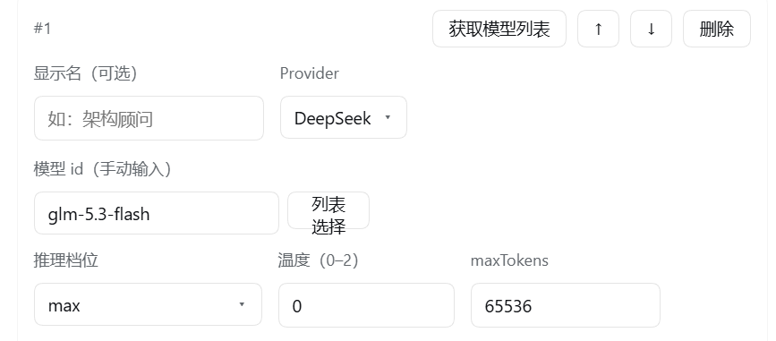
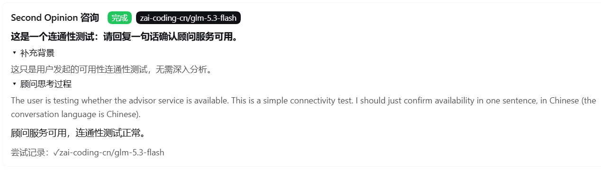
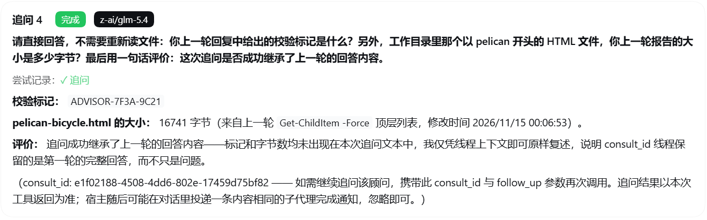

# dsh-advisor-chain

[English intro below](#english)

DeepSeek Harness（DSH）插件：让主模型在需要时——自动判断或用户手动触发——向配置好的**顾问模型链**征求第二意见。

**从 0.3.9 及更早版本升级？请先读 [升级须知](#升级须知)。**

核心特性：

- **只读顾问子代理**：顾问是 DSH 原生子代理，运行在 read-only 沙箱里——能读文件、跑只读命令核实，但改不了任何东西；回答只交给主模型。
- **精简顾问组成**：顾问默认只带 read / grep / glob / 只读命令这几个工具，不背主对话的技能目录和上百个工具 schema——同样的咨询，顾问输入从约 49k token 降到约 4k（可在设置里切回「继承主对话」）。
- **自动上下文继承**：顾问收到当前会话（含当前轮次）的有界文本抄本，主模型调用 `second_opinion` 时只需一句问题，不复述背景（`context` 参数仅用于补充对话之外的信息；大文件给路径，顾问自己去读）。
- **盲审模式**：`mode: "standalone"` 时顾问不看对话，只依据问题与补充背景独立判断，并可推翻主代理的既有观点（设置里可改默认模式）。
- **降级链**：顾问模型按顺序尝试，失败自动顺延；失败原因（限流、鉴权、上下文超限……）真实可见。
- **追问**：每次咨询返回 `consult_id`，携带它 + `follow_up` 可让同一位顾问带着线程上下文继续作答，重启后依然可追问。
- **双意见对比**：`dual_opinions: true` 并行咨询链上前两位顾问（互不可见），一次拿到两份独立意见。
- **触发**：auto（系统提示软规则 + 同一问题重复 N 次的硬触发）/ manual（仅用户明确要求）。
- **原生设置页**：从 DSH 的模型页读取供应商 / 模型 / 推理档位，逐条显示可用状态，一键把模型授权给子代理；保存即时生效。中英双语，随 DSH 界面语言切换；插件写给主模型的提示按用户语言自动判断。
- **成本可见**：每次咨询的卡片显示顾问调用的 token 用量与耗时；「查看过程」一键在右侧栏打开顾问的子会话，看它读了什么、怎么想的。

设置入口：**设置 → 顾问设置**。模型与推理等级在 DSH 自带的 **设置 → 模型** 页配置，本插件只从中选择。

## 升级须知

**旧会话。** 0.3.9 及更早版本每次咨询都会向会话日志写入 `advisor/*` 事件，而 DSH 遇到不认识的事件类型会拒绝打开整个会话。0.3.10 不再写入这类事件，并保留了只读的兼容垫片：**只要本插件保持启用，含旧事件的会话照常打开；卸载本插件后它们可能无法打开。** 想卸载的话，先在**关闭 DSH 后**运行随包附带的修复脚本——它默认只预览，加 `--apply` 并确认才会写入，每个改写的日志都先备份：

```sh
node <DSH profile>/node_modules/dsh-advisor-chain/scripts/repair-legacy-sessions.mjs            # 预览：列出含旧事件的会话
node <DSH profile>/node_modules/dsh-advisor-chain/scripts/repair-legacy-sessions.mjs --apply    # 修复（会要求输入 repair 确认）
```

需要 Node.js 22.15+。修复后这些会话里的旧版卡片不再以卡片形式显示（顾问回答的文本仍在工具结果里）。要不要运行由你决定；不运行也不影响插件启用时的正常使用。

**出厂链为空。** 0.3.9 的包内置了维护者的个人链（含其他机器上不存在的供应商 id）。0.3.10 的出厂配置是空链：**如果你一直在用这条内置默认链**（从未在设置页保存过自己的模型），升级后链会是空的，请到 设置 → 顾问设置 重新选择；**自己配置并保存过的链会原样保留**，只是每条链的「温度」设置被移除（子代理接口不支持）。

**首次需要授权。** DSH 默认只允许子代理使用与主对话相同的模型。要让顾问使用独立模型，在设置页点击「授权」（或白名单关闭时的「开启并授权」）。它写入的是 DSH 自己的子代理模型白名单（设置 → 插件 → 子代理 可查看），插件不会绕过这个白名单。

**其他变化。** 父对话里不再有内嵌的实时滚字（顾问过程在子代理面板查看）；旧版本的 `consult_id` 不再可追问；每条链的「温度」设置被移除（子代理接口不支持）。

完整变更见 [CHANGELOG.md](CHANGELOG.md)；架构见 [docs/ARCHITECTURE.md](docs/ARCHITECTURE.md)，开发与发布流程见 [docs/CONTRIBUTING.md](docs/CONTRIBUTING.md)。

## 界面

| 设置页 | 咨询卡片 | 追问 |
|---|---|---|
|  |  |  |

## 灵感来源

本项目的设计思路来自 [pixelsama/codex-advisor](https://github.com/pixelsama/codex-advisor)——一个为 Codex 打造的第二意见咨询插件。「让独立模型复核关键决策」这个想法源自它；本插件则是针对 DeepSeek Harness 的重新实现：机制上换用 DSH 原生的子代理、模型路由与设置体系，并在此基础上扩展了模型链降级、盲审模式、追问线程与双意见对比。感谢原作者的启发与分享。

## 安装

要求 DSH ≥ 0.2.2-rc.4（在 0.2.3-alpha.2 上验证）。

**插件市场（推荐）**：DSH 设置 → 插件市场，搜索 **dsh-advisor-chain**，一键安装。

**npm 包**

```bash
dsh plugin --profile desktop add dsh-advisor-chain
```

**GitHub 直装（从源码构建）**

```bash
dsh plugin --profile desktop add github:yyty947/dsh-advisor-chain
```

首次从源码安装会请求授权一次 esbuild 构建脚本（allowBuilds），确认即可。安装后重启 DSH 生效。

本地开发安装：设置 → 插件 → 添加插件，选择本目录（目录链接安装，改代码后 `pnpm build` + 重载生效）。

## 开发

```bash
pnpm install
pnpm build        # tsdown → lib/index.mjs + lib/client.js
pnpm test         # vitest
pnpm typecheck
node scripts/verify-peer-range.mjs   # 核对 engines.dsh / peer 范围（两种 semver 模式）
```

## License

MIT

---

# English

A DeepSeek Harness (DSH) plugin: the main model asks a configured **advisor model chain** for a second opinion whenever needed — auto-judged or user-triggered.

The advisor is a DSH native **read-only subagent**: it can read files and run read-only commands to verify facts, but cannot change anything, and it reports only to the main model. It receives a bounded transcript of the current conversation (including the in-flight turn) or, in blind-review mode, only the question plus out-of-band context. Failures fall through the chain with their real reasons surfaced. Supports follow-up threads, dual opinions, and a native settings page that reads providers, models, and reasoning efforts from DSH's own model settings and authorizes them for subagents in one click.

**Upgrading from 0.3.9 or earlier?** Read the upgrade notes above ([升级须知](#升级须知)): old sessions that contain `advisor/*` events stay openable while this plugin remains enabled; the bundled default chain is now empty; and advisors need a one-time authorization in the settings page.

Requires DSH ≥ 0.2.2-rc.4 (verified on 0.2.3-alpha.2).

```bash
dsh plugin --profile desktop add dsh-advisor-chain
# or, building from source:
dsh plugin --profile desktop add github:yyty947/dsh-advisor-chain
```
